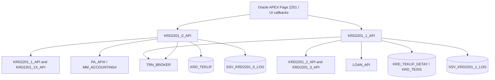

# Architecture and dependencies

## High-level component map

**Diagram note:** Connections are observed code references, not a complete deployed component diagram.

## Important database objects observed

| Object | Observed role |
| --- | --- |
| `SSV_KRD2201_0_LOG` | Master-side staged transaction records |
| `SSV_KRD2201_1_LOG`, `SS_KRD2201_1_LOG` | Detail-side staged transaction records / lookup |
| `SS_KRD2201_1X_LOG`, `SS_KRD2201_3_LOG` | Supplementary memorandum, contract and schedule information |
| `KRD_TEKLIF` | Master offer record created by `KRD2201_0_API.DO_NEW` |
| `KRD_TEKLIF_DETAY` | Loan/offer detail record inserted by `KRD2201_1_API.DO_NEW` |
| `KRD_TESIS` | Loan-related record inserted/removed during detail handling |
| `LM_FLOW` | Upstream memorandum status and reference updates |
| `GL_JOURNAL_LINES` | Checks for accounting journal statuses |
| `CS_ACCOUNT` | Payment account lookup |
| `XIRR_SCHEDULE_TMP` | Temporary calculation input for XIRR / IRR algorithm; storage isolation is unverified |

## Known integration calls
`TRN_BROKER.REGISTER`, `TRN_BROKER.SETTXSTEP`, `TRN_BROKER.SETTXSTATE`, `TRN_BROKER.WF_SET_PARAMETER`, `LOAN_API.CREATE_ACCOUNT`, `LOAN_API.CREATE_LOAN_HISTORY`, `LOAN_API.CHANGE_ACCOUNT_STATUS`, `MM_ACCOUNTING#.POST_JOURNAL`, `PA_API#.CREATE_J`, `GLBL_REPORT.PRINT_FORM_DOCUMENTS`.

Only caller-side behavior is documented; the called package contracts were not supplied.
