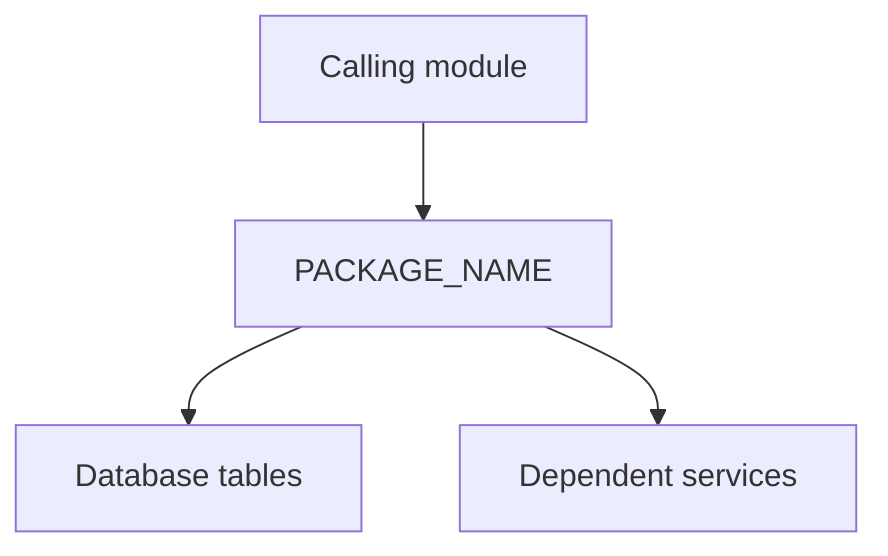

# PACKAGE_NAME

## 1. Overview

**Purpose:** [Explain in 2-3 sentences what the package does.]

**Business context:** [Explain why it exists and which workflow uses it.]

**Source:** `[SCHEMA].[PACKAGE_NAME]` (package specification / body)

## 2. Architecture and workflow



**Workflow:**
1. [Input received]
2. [Validation]
3. [Core processing]
4. [Result or error]

## 3. Dependencies

| Object | Type | Role | Confirmed from source? |
|---|---|---|---|
| TABLE_NAME | TABLE | [How it is used] | Needs Review |

## 4. Public API

### PROCEDURE_NAME

**Purpose:** [What it does]

**Signature:**

```sql
PROCEDURE PROCEDURE_NAME(p_id IN NUMBER, p_result OUT VARCHAR2);
```

| Parameter | Direction | Type | Meaning | Required |
|---|---|---|---|---|
| p_id | IN | NUMBER | [Business meaning] | Yes |
| p_result | OUT | VARCHAR2 | [Returned result] | N/A |

**Preconditions:** [Required state and validation]

**Postconditions / side effects:** [Tables modified and external calls]

**Transaction behavior:** [Commit / rollback ownership; Needs Review]

**Exceptions:** [Error codes, triggers, recovery action]

**Usage example:**

```sql
DECLARE
  l_result VARCHAR2(4000);
BEGIN
  PACKAGE_NAME.PROCEDURE_NAME(p_id => 1, p_result => l_result);
  DBMS_OUTPUT.PUT_LINE(l_result);
END;
/
```

## 5. Business rules

| Rule | Description | Evidence | Status |
|---|---|---|---|
| BR-001 | [Rule] | [Source line / discussion] | Needs Review |

## 6. Security and access

[Roles, grants, sensitive information handling. Never paste secrets.]

## 7. Troubleshooting

| Symptom / error | Possible cause | Resolution |
|---|---|---|
| [ORA-xxxxx] | [Reason] | [Action] |

## 8. Change log

| Date | Version | Change | Reviewer |
|---|---|---|---|
| YYYY-MM-DD | 0.1 | Initial draft | Pending |

## 9. Review checklist

- [ ] Signature matches package specification
- [ ] Business purpose approved by domain owner
- [ ] Parameter and return descriptions checked
- [ ] Transaction and side-effect behavior verified
- [ ] No secrets or confidential data
- [ ] Customer/internal audience classification approved
