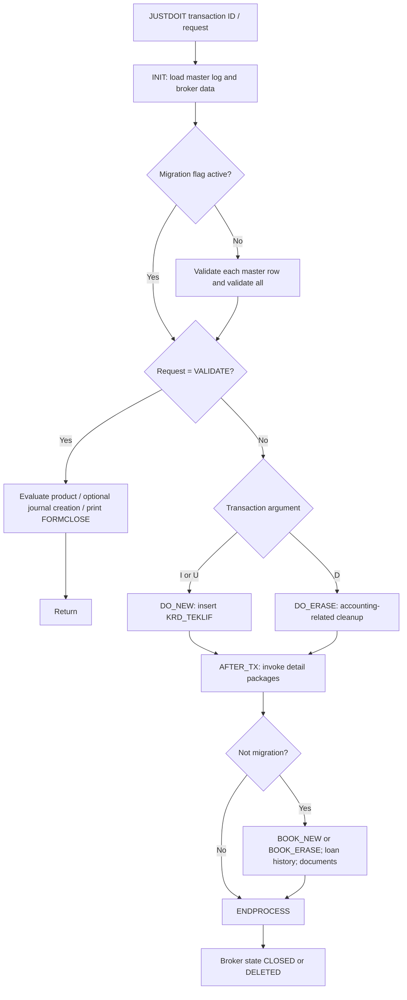

# Execution workflows

## Master execution — `KRD2201_0_API.JUSTDOIT`

`KRD2201_0_API.VALIDATE_ALL` invokes `KRD2201_1_API.JUSTDOIT(tx, 'VALIDATE')`. `KRD2201_0_API.AFTER_TX` invokes `KRD2201_1_API.JUSTDOIT(tx, 'ALL')` then `KRD2201_1X_API.JUSTDOIT(tx, 'ALL')`.

## Detail execution — `KRD2201_1_API.JUSTDOIT`

1. `INIT` reads detail log rows and transaction metadata.
2. Unless migration flag is set: each row executes `VALIDATE_ROW` and `OPEN_CARI_ACC`, then `VALIDATE_ALL` invokes `KRD2201_2_API` and `KRD2201_3_API` validation.
3. With `p_Request = 'VALIDATE'`: `KRD2201_2_API.DO_NEW(NULL)` is invoked and the procedure returns. **This side effect should be reviewed** before treating VALIDATE as read-only.
4. Otherwise, `I`/`U` follows `DO_NEW`; `D` follows `DO_ERASE`.
5. `AFTER_TX` invokes `KRD2201_3_API.JUSTDOIT(..., 'ALL')`.
6. For non-migration processing, master offer may be deleted on `D`; the package subsequently runs `BOOK_NEW` (currently contains no accounting implementation) and ends process.

## Validation examples observed
- Payment-plan row must be available and the main payment date populated.
- Main payment date must be after contract date; contract date compared against `GLBL.GETSYSDATE`.
- Specific credit-line types (`KK`, `KX`) hit an unconditional failed assertion in the supplied code.
- `QN` requires schedule type `16`.
- In insertion processing, memorandum and contract duplicates are checked.
- Offer amount is checked against `KRD_SCOR_MAIN.KRD_AMOUNT_T`.

## Scope warning
No claim is made that these are the full product rules: other called packages and APEX validations are outside the supplied evidence.
